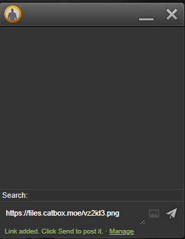
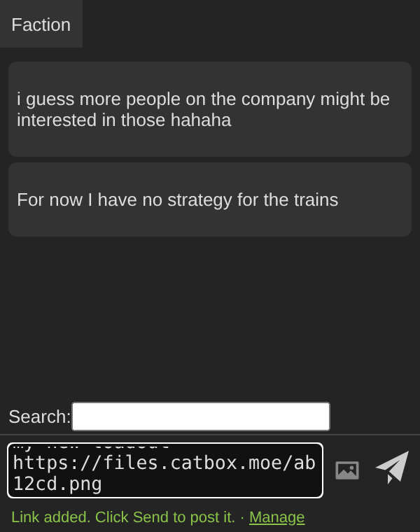

# Torn Chat Image Upload

**Share a picture in Torn chat in two clicks.** An image button sits left of the Send button in every chat window.
Pick or paste a picture: it goes to [Catbox](https://catbox.moe) and the link lands in the chat box. **You click Send.**

  
  

Left: real Torn chat. Right: phone width. The link is in the box, waiting for Send.

## Features
- **Image button left of Send** in every open chat (faction, company, private, global).
- **No key, no sign-up.** Uploads work right after install.
- **Paste works too.** Ctrl+V a screenshot into a chat box and it uploads. Text you copy (even from Excel or Word) pastes as text.
- **Never sends for you.** The link goes in at the cursor; your text stays; you press Send.
- **Last 20 uploads**: right-click the image button. With a Catbox user hash (optional) each one gets **Delete**.
- PNG, JPEG, GIF and WebP.

## Install
1. Get a userscript manager ([Tampermonkey](https://www.tampermonkey.net/) or [Violentmonkey](https://violentmonkey.github.io/)).
2. Install `torn-chat-image-upload.user.js` from this folder. Your userscript manager asks once to allow `catbox.moe`.
3. Click the image button in any chat and pick a picture.

Optional, to be able to delete uploads: make a free account on [catbox.moe](https://catbox.moe), copy your user hash
from your account page, then right-click the image button, paste it in the user hash box and click Save.

<b>Privacy</b>

- **Anyone with the link can see the image.** Check a screenshot before you share it: API keys, items and messages show up easily.
- Anonymous uploads **cannot be deleted** and stay until 2 years without views. Uploads with your user hash are permanent until you delete them
  ([Catbox FAQ](https://catbox.moe/faq.php)).
- Nothing is sent anywhere until you pick or paste an image.

<b>Compliance</b>

Torn's rule: scripts may use the API or the page you are viewing, and must not make non-API requests to Torn
that you did not trigger by hand ([Chedburn, forum thread 16000717](https://www.torn.com/forums.php#/p=threads&t=16000717)).
This script makes **no requests to Torn at all**: no Torn API, no Torn key. It only adds a button and text to the chat box;
**you** press Send. The only other site is `catbox.moe` (`@connect catbox.moe`), called only when you pick or paste an image
(or press Delete). No alerts, no background work in hidden tabs.

| Torn API ToS | |
| --- | --- |
| Data storage | Last 20 links (and your optional Catbox user hash), only in your userscript manager |
| Data sharing | The image you choose goes to Catbox; nothing else is shared |
| Purpose of use | Sharing images in Torn chat |
| Key storage & sharing | No Torn key used |
| Key access level | None |

## Source

`torn-chat-image-upload.user.js` is the whole script, one file with no dependencies.

Tests: `node --test "Torn Chat Image Upload/tests/row.pw.mjs"` (Playwright, on a mock built from Torn's chat HTML). Phone screenshot: `node "Torn Chat Image Upload/tests/shots.mjs"`.

Made by [KamiRen [2805199]](https://www.torn.com/profiles.php?XID=2805199).
