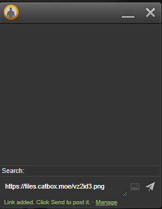

<b>Share a picture in Torn chat in two clicks.</b> An image button sits left of the Send button in every chat window. Pick or paste a picture: it goes to <a href="https://catbox.moe">Catbox</a> and the link lands in the chat box. <b>You click Send.</b>

<h2>What it does</h2>
<ul>
<li><b>Image button left of Send</b> in every open chat.</li>
<li><b>No key, no sign-up:</b> works right after install.</li>
<li><b>Paste works too:</b> Ctrl+V a screenshot into a chat box and it uploads. Copied text still pastes as text.</li>
<li><b>Never sends for you:</b> the link goes in at the cursor, your text stays, you press Send.</li>
<li><b>Last 20 uploads:</b> right-click the image button. With an optional Catbox user hash each one gets <b>Delete</b>.</li>
<li>PNG, JPEG, GIF and WebP.</li>
</ul>
<h2>Good to know</h2>
<ul>
<li><b>Anyone with the link can see the image.</b> Anonymous uploads cannot be deleted (they expire after 2 years without views). Right-click the image button and add your Catbox user hash to be able to delete.</li>
<li>No requests to Torn at all, no Torn key. The only other site is catbox.moe, called only when you pick or paste an image.</li>
</ul>

<b>API key use (Torn API ToS)</b>

<ul>
<li><b>Data storage:</b> last 20 links and your optional Catbox user hash, only in your userscript manager.</li>
<li><b>Data sharing:</b> the image you choose goes to Catbox; nothing else.</li>
<li><b>Purpose of use:</b> sharing images in Torn chat.</li>
<li><b>Key storage and sharing:</b> no Torn key used.</li>
<li><b>Key access level:</b> none.</li>
</ul>

Made by <a href="https://www.torn.com/profiles.php?XID=2805199">KamiRen [2805199]</a>. Source and issues: <a href="https://github.com/Yoonutz/torn-scripts/tree/main/Torn%20Chat%20Image%20Upload">GitHub</a>

