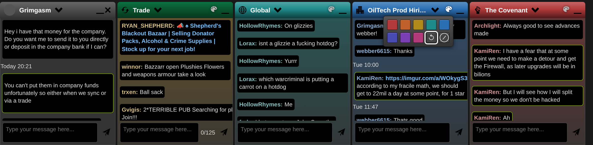
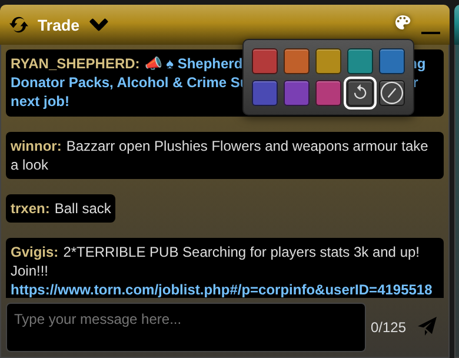

# Torn Colored Chats

**Know which chat is which at a glance.** Each group chat window (faction, company, global, trade and the others) gets its own color:
a colored header and a light tint of the same color behind the messages. **Private chats stay as they are.**

  

  

## Features
- **One color for each group chat.** Defaults: faction red, company blue, global teal, trade amber, other group chats purple.
- **Palette icon in the header**, left of the minimize line. It is grey like Torn's own icons. Click it and select one of 8 colors,
  **↺** for the default color or **⊘** for no color. Your choice stays after a reload.
- **Private chats are not changed.** They get no color and no icon.
- **Torn's green "new message" header still shows.** The color comes back when you read the message.
- **Sender names** in group chats get a light shade of the chat color.
- No green in the palette, so a new message is always easy to see.
- Works in the dark and the light Torn theme.

## Install
1. Get a userscript manager ([Tampermonkey](https://www.tampermonkey.net/) or [Violentmonkey](https://violentmonkey.github.io/)).
2. Install `torn-colored-chats.user.js` from this folder.
3. Open a faction or company chat. To change its color, click the palette icon in its header.

<b>Compliance</b>

Torn's rule: scripts may use the API or the page you are viewing, and must not make non-API requests to Torn
that you did not trigger by hand ([Chedburn, forum thread 16000717](https://www.torn.com/forums.php#/p=threads&t=16000717)).
This script makes **no requests at all**: no Torn API, no Torn key, no other site. It only changes how the chat windows look.
No alerts, no work in hidden tabs.

| Torn API ToS | |
| --- | --- |
| Data storage | Your color for each chat, only in your userscript manager |
| Data sharing | None |
| Purpose of use | Coloring Torn chat windows |
| Key storage & sharing | No Torn key used |
| Key access level | None |

## Source

`torn-colored-chats.user.js` is the whole script, one file with no dependencies.

Tests: `node --test "Torn Colored Chats/tests/chats.pw.mjs"` (Playwright, on a mock built from Torn's chat HTML).
Screenshots: `node "Torn Colored Chats/tests/shots.mjs"`.

Made by [KamiRen [2805199]](https://www.torn.com/profiles.php?XID=2805199).
