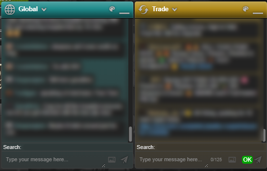

<b>Know which chat is which at a glance.</b> Each group chat window (faction, company, global, trade and the others) gets its own color: a colored header and a light tint behind the messages. <b>Private chats stay as they are</b>, until you give one a color.

<h2>What it does</h2>
<ul>
<li><b>One color for each group chat.</b> Defaults: faction red, company blue, global teal, trade amber, other group chats purple.</li>
<li><b>Palette icon in the header</b>, grey like Torn's own icons. Click it and select one of 8 colors, ↺ for the default or ⊘ for no color.</li>
<li><b>Sender names</b> in group chats get a light shade of the chat color.</li>
<li><b>Private chats have no color by default.</b> The palette icon is there too, so you can color one when you want.</li>
<li><b>Torn's green "new message" header still shows.</b> No green in the palette, so new messages stay easy to see.</li>
<li>Dark and light Torn theme.</li>
</ul>
<h2>Good to know</h2>
<ul>
<li>No requests at all: no Torn API, no Torn key, no other site.</li>
</ul>

<b>API key use (Torn API ToS)</b>

<ul>
<li><b>Data storage:</b> your color for each chat, only in your userscript manager.</li>
<li><b>Data sharing:</b> none.</li>
<li><b>Purpose of use:</b> coloring Torn chat windows.</li>
<li><b>Key storage and sharing:</b> no Torn key used.</li>
<li><b>Key access level:</b> none.</li>
</ul>

Made by <a href="https://www.torn.com/profiles.php?XID=2805199">KamiRen [2805199]</a>. Source and issues: <a href="https://github.com/Yoonutz/torn-scripts/tree/main/Torn%20Colored%20Chats">GitHub</a>

