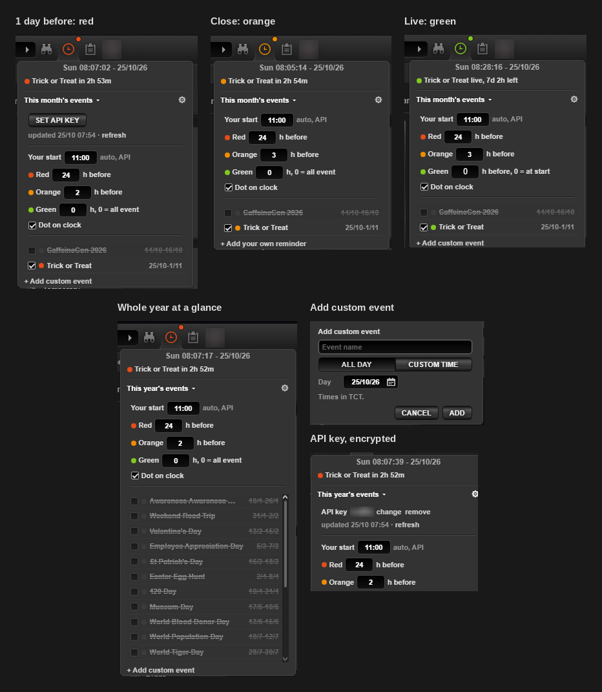
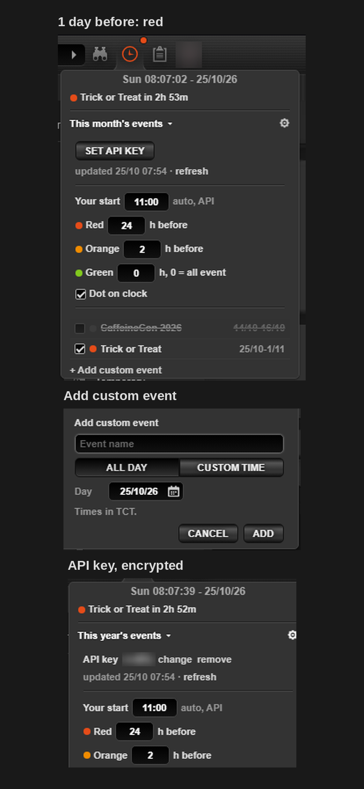

# Torn Event reminder

**Never miss the start of a Torn event again.** Torn's header clock turns red a day before, orange when it's close and green while the event is live, timed to your own event start.

  
  

Desktop and phone, on the live Torn page. Avatar and key blurred.

## Features
- **Colored clock.** Red, orange and green on Torn's own clock icon, with the next event under the time.
- **Your start time.** Reads your personal event start from the API or the calendar page.
- **Pick your events.** This month, this year or just the next one, a checkbox each.
- **Custom events.** Add your own, a whole day or a from-to time, with calendar and clock pickers.

## Install
1. Get a userscript manager ([Tampermonkey](https://www.tampermonkey.net/) or [Violentmonkey](https://violentmonkey.github.io/)).
2. Install `torn-event-reminder.user.js` from this folder.
3. Open Torn's clock, press ⚙ and **Set API key** (or open the [calendar](https://www.torn.com/calendar.php) once).

<b>Colors and timing</b>

| Clock | When |
| --- | --- |
| Red | 24 h or less before an event you watch starts (editable) |
| Orange | 3 h or less before the start (editable) |
| Green | the event is live, or from the hours you set before the start (0 = at start) |
| Normal | nothing due |

Most Torn events start at the time you picked, not at 00:00 TCT. The script reads it from
`user/calendar`, or from the calendar page, where the times shown
(`11:00:00 - 25/10/26 until 11:00:00 - 01/11/26`) win over the API.

The clock dropdown keeps Torn's time on the first row, the due events on the second, then
the list. The view button cycles **This month's events**, **This year's events** and
**Next event**. Ended events are struck through and unticked; events that started last
month and still run stay in the list, marked *from Oct* etc.

<b>API key</b>

⚙ → **Set API key**. If another script already saved a Torn key in this browser, it is offered
for reuse. Otherwise the link opens Torn's key page pre-filled with a custom key that can only
read the calendar (`user/calendar` needs more than a Public key). The pasted key is checked
against the API, then saved AES-encrypted: the encryption key is a non-extractable browser
key in IndexedDB, so the API key is never plain text in localStorage.

<b>Custom events</b>

**+ Add custom event** under the list: a name, then **All day** (one date) or **Custom time**
(from and to, date and time, TCT). The calendar and clock icons open themed pickers; typing
`26/10`, `26/10/26` or `8:00` works too. Custom events get the same colors and show in the
list with ✎ edit and ✕ delete.

<b>Compliance</b>

Reads Torn's own pages (calendar times, the header clock) and changes only how the clock and
its dropdown look. Calls `api.torn.com` with your own key, every 6 hours and when you press
refresh. No automation, nothing is clicked for you, nothing leaves your browser except those
API calls.

