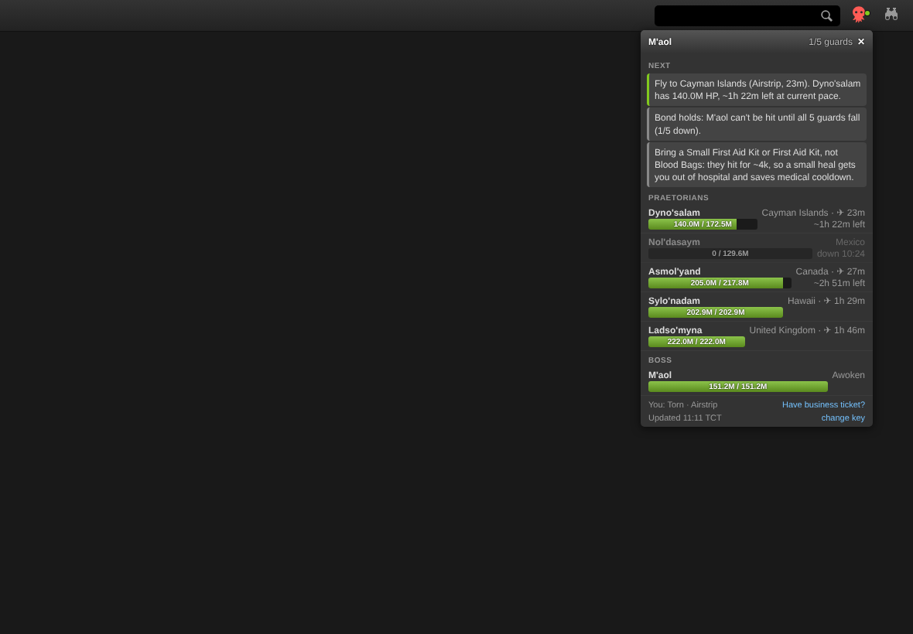
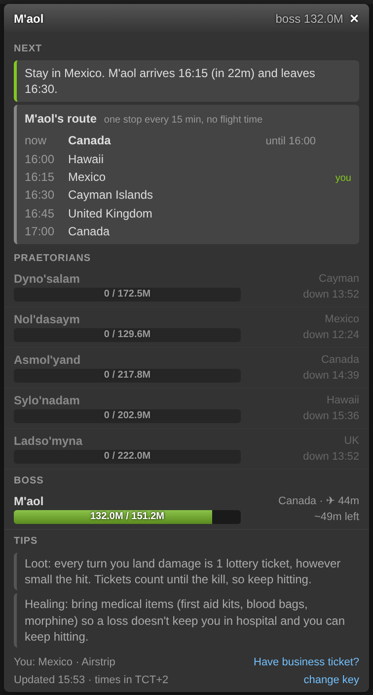

# Torn M'aol tracker

**Live M'aol and Praetorian status, with the flight time each one costs you and what to do next.**
A button in Torn's header, left of the search, opens a Torn-styled dropdown.

  
  

Desktop and phone, replaying 26 Oct 2026 at 15:53: M'aol is coming to Mexico.

## Features
- **Header button.** Next to the binoculars on desktop, left of the magnifier on phones. Red while M'aol is summoned. Green dot: something to do now. Orange: action on, nothing reachable.
- **All six NPCs.** Country, HP bar and time until each one falls, from the HP drop over the last 5 min.
- **Your flight times.** Reads your travel perks (airstrip, WLT, travel book), adds the trip home when you are abroad
  and any hospital, jail or flight you are still in. Toggle *business ticket* to see those times.
- **What to do next.** Hit now, fly to the nearest guard you can still reach, skip the ones that die before you land.
- **M'aol's timetable.** Where he is, when he leaves and his next stops with times, even before the bond breaks.
- **Stay or fly.** The first stop you can reach while he's still there: "Stay in Mexico, he's here 16:15–16:30" or "Fly to Canada".
- **Next summon countdown.** While all are dormant: when the next summon is due, about 48h after M'aol's kill.
- **Sleeps when there's no event.** Zero API calls outside Halloween week.
- **Times in your own clock.** The footer shows the offset from TCT.

## Install
1. Get a userscript manager ([Tampermonkey](https://www.tampermonkey.net/) or [Violentmonkey](https://violentmonkey.github.io/)).
2. Install from [Greasy Fork](https://greasyfork.org/en/scripts/602300-torn-m-aol-tracker) (or `torn-maol-tracker.user.js` from this folder).
3. Click the button left of the search and paste a Minimal access API key. Torn PDA fills it in by itself.

<b>How it works</b>

- NPC IDs: M'aol 23, Dyno'salam 100, Nol'dasaym 101, Asmol'yand 102, Sylo'nadam 103, Ladso'myna 104.
- M'aol's route (checked live on 26 Oct 2026, 9 of 9 stops right): he loops through the dead guards' countries in the order
  they died, one stop every quarter hour (:00 :15 :30 :45 TCT), with no flight in between. A guard that dies later joins the
  end of the loop, and he starts moving while the bond still holds.
- Missed deaths: if the script didn't see some guards die, it takes their defeat times from the public
  [chain-race M'aol feed](https://live.chain-race.workers.dev/maol.html) (by LDP [1580562]), or else learns the loop from M'aol's own moves (one full loop).
- API use (refresh every 15 s, only while a Torn tab is visible, shared across tabs):

  | When | Calls |
  | --- | --- |
  | Event on | Your `user/basic` + each living NPC's `user/{id}/profile`: at most 7 per refresh, 28/min (28% of the 100/min key limit) |
  | Dead NPCs | Once every 10 min each instead of every refresh |
  | Halloween week, everything dormant | 1 call (M'aol) every 10 min, to catch a new summon |
  | Outside Halloween week | None |
  | Extras | `user/travel` while you fly, `user/perks` every 6 h |
  | chain-race feed (not Torn) | Only when deaths or M'aol's kill were missed: every 2 min during the event, every 10 min while dormant |

- A failed call keeps the last data on screen and retries on the next refresh.
- Flight times: standard minutes from the [wiki](https://wiki.torn.com/wiki/Travel), airstrip ×0.7, WLT ×0.5,
  business ×0.3, travel book ×0.75. Real flights vary about 3%.
- Kill times use the last 5 min of HP loss. Under 5% HP M'aol's shield slows the kill, so no time is shown there.

<b>Compliance</b>

Reads the Torn API with your own key, at most 28 calls a minute only while a Torn tab is visible, none outside Halloween week.
No other requests to Torn. The only other site is the public chain-race feed (`@connect live.chain-race.workers.dev`), read-only: nothing is sent to it, no key, no name. Adds one header button
and a dropdown; never clicks, attacks or travels for you. Links take you to the attack or travel page, you act yourself.
The key stays in Tampermonkey's own storage (a key saved by an older version moves there by itself), the last snapshot in this browser's localStorage.

| Torn API ToS | |
| --- | --- |
| Data storage | Only locally, in this browser |
| Data sharing | Nobody |
| Purpose of use | Personal M'aol and Praetorian tracking |
| Key storage & sharing | Stored locally, never shared |
| Key access level | Minimal |

## Source

The code lives in [`plugin.js`](plugin.js) (header in [`header.js`](header.js)). `torn-maol-tracker.user.js` is built from them with the shared [occ-kit](../occ-kit/README.md): `node occ-kit/build.mjs`. Do not edit the built file by hand. The same plug-in also runs inside the private Command Center; when both are installed this copy steps aside so nothing runs twice.
