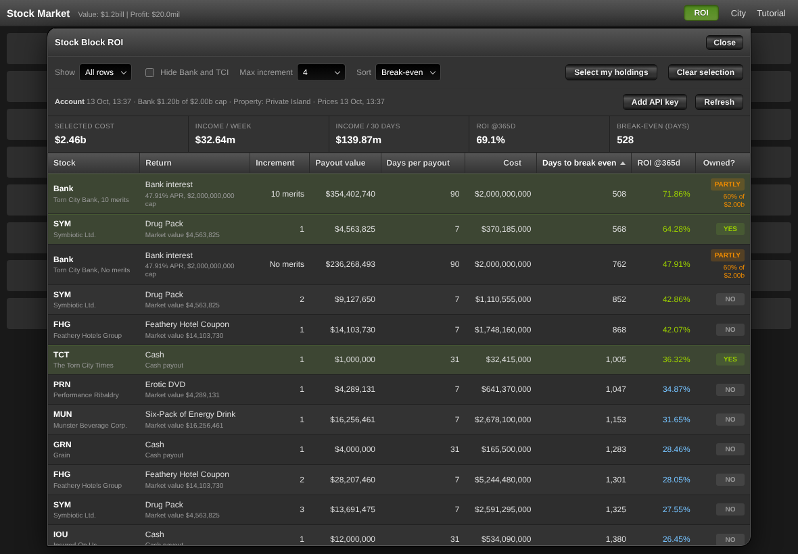
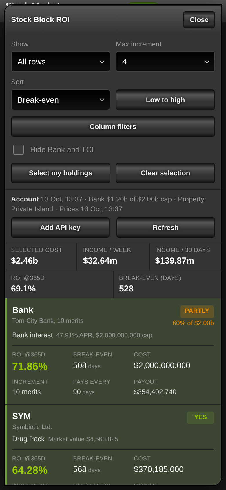

# Torn Stock Block ROI

**Which Torn stock should you buy next?** Ranks every stock benefit block, plus the bank and TCI, by how
fast each one pays for itself.

  
  

Demo account.

## Features

- **One scale for everything.** Cash, items and points blocks (increments 1 to 4) compared by days to
  break even and yearly ROI, using live prices and live item values.
- **Knows your account.** Shows what you own, your bank deposit and your bank cap (Oil Rig aware).
- **Pick and total.** Select rows to see their combined cost, weekly and monthly income and ROI.
- **Sort and filter any column.** Click a header to sort, or to keep only the values you tick (say
  increment 1, or increments 2 and 3) or a number range. Filters stack and are remembered.
- **Desktop and Torn PDA.** Opens instantly from cache, refreshes only when the data is old.

## Install

1. Get a userscript manager ([Tampermonkey](https://www.tampermonkey.net/) or
   [Violentmonkey](https://violentmonkey.github.io/)), or use Torn PDA.
2. Install `Torn-Stock-ROI.user.js` from this folder.
3. Open the [stock market](https://www.torn.com/page.php?sid=StockMarket), press **ROI** and paste a
   Torn API key (Limited Access is enough). Torn PDA uses your PDA key automatically.

<b>Reading the table</b>

| Column | Meaning |
| --- | --- |
| Stock | Acronym and name |
| Return | What it pays, with the item's market value underneath |
| Increment | 1 to 4 (bank and TCI: *No merits* / *10 merits*) |
| Payout value | One payout at that increment |
| Days per payout | 7 or 31 for stocks, 90 for the bank |
| Cost | Shares needed x share price |
| Days to break even | Cost / (payout / days per payout) |
| ROI @365d | Yearly payout / cost |
| Owned? | **YES** if you hold that increment or more. Bank: **YES** at the cap, **PARTLY** below it |

Increment *n* needs requirement x (2^*n* - 1) shares in total and pays *n* x the base return
([Torn wiki](https://wiki.torn.com/wiki/Stock_Market)).

<b>Sort and filter</b>

- Click a column header: **Sort A to Z** or **Z to A** (smallest or largest first for numbers).
- Stock, Return, Increment, Days per payout and Owned? also get a search box and a checklist. Five
  rows show, the rest scrolls. **(Select All)** applies to what the search shows.
- Payout value, Cost, Days to break even and ROI @365d get **Min** and **Max** (both included). You
  can type `5m`, `2b` or `750k`.
- Filters stack with each other and with **Show**, **Max increment** and **Hide Bank and TCI**. Each
  active filter is a chip above the table: click it to remove it, or use **Clear filters**.
- Fastest payback among increment 1: tick only 1 under Increment, then sort Days to break even
  smallest to largest.
- On a phone the header row is gone: use **Sort** and **Column filters** at the top.

<b>Bank and TCI</b>

- Bank cap is $2,000,000,000, or $3,000,000,000 with an Oil Rig. Detected from your property.
- Merits (x1.5 interest) are detected from the interest your deposit earned.
- TCI pays 10% of the bank interest. The deposit and shares come back, so break-even there is a yield
  measure, not a payback.
- Not included: passive stocks, HRG, BAG, EVL, MCS, CBD. Clothing Cache is an estimate (average of
  the seven caches) and marked *Est.*

<b>Window, API key and cached data</b>

- The window floats over the page. Drag it by the title bar, double-click the bar to recentre it. On
  phones it fills the screen and the table becomes cards.
- Your key is stored only in your browser (localStorage) and sent only to `api.torn.com`.
- Cached as small objects with lists: `tsr.key`, `tsr.account`, `tsr.market`, `tsr.selection`,
  `tsr.settings`. Pressing ROI refreshes only when the cache is older than five minutes. **Refresh**
  forces it.

<b>Compliance</b>

Torn's Scripting Abuse rule permits software that relies on the API, or on a page you have manually
loaded and are actively viewing, and forbids non-API requests that are not directly and manually
initiated by you. This script reads nothing from the page and clicks nothing. Its only network calls go
to the official API with your own key, after you press ROI (stale cache) or Refresh.

